# TimesFM 3.0: how the model works, read from the code (draft of Section 3)

## 0. Source snapshot and conventions

| Item | Value |
|---|---|
| Directory analysed | `dl_tfm/timesfm-HEAD/` (extracted from `dl_tfm/repo.tgz`) |
| Git commit (from tarball pax header, `git get-tar-commit-id`) | `e51928e27119cb17bebc005be2696b75e0a9e688` |
| Tarball SHA-256 | `c20a3d86f182791bdd003ef4cfe87aa3793ec211166b1d864fd54c373c06af1f` |
| `pyproject.toml` | `name = "timesfm"`, `version = "3.0.2"` (pyproject.toml:2-3) |
| Backend analysed | PyTorch, `src/timesfm3/torch/` (MLX port `src/timesfm3/mlx/` was used only as a cross-check) |
| Checkpoint referenced by the code | `google/timesfm-3.0-pytorch` (timesfm3_forecaster.py:42, 350) |

Unless stated otherwise, paths are relative to `src/timesfm3/torch/`. Paths outside that folder are written relative to the repo root.

**Label legend.** **[Code]** means the cited lines directly show the claim. **[Inference]** means it is my reasoning from the code and has not been confirmed by running anything. **[Unknown]** means the code alone cannot settle it, usually because the value lives in the HF `config.json`, which is not in the repo and was not read.

**Important caveat [Code].** When the model is loaded from the Hub, `TimesFM3Torch.from_pretrained` builds its constructor arguments from the checkpoint's `config.json` (timesfm3_forecaster.py:383-414; model.py:37-41 uses `PyTorchModelHubMixin`). The architectural defaults in the code are therefore only defaults. Three values matter and could not be checked: `use_rope_var`, `causal_attention` and `input_transform`. The other dimensions agree with the blog, and the parameter count in §3.6 supports them.

**User flags are overridden on Hub loads [Code].** `ModelConfig` fields such as `use_variate_attention`, `use_stitching`, `use_linear_detrending` and `use_iterative_cpm_revin` reach the model only on the local-file path (`_make_torch_model`, timesfm3_forecaster.py:314-328). On a Hub or directory load, the model is built from `config.json` and `self.config` is then **overwritten** with the model's values (398-414), so anything the user passed is discarded. `ModelConfig.use_sdpa` (86) is **never read** on either path. The `use_variate_attention=True, use_sdpa=True` arguments in Google's benchmark runners therefore do nothing. To ablate a mechanism, set the attribute on the loaded module instead, for example `forecaster.model.use_linear_detrending = False`, or `mha.use_sdpa = False` on each `MultiHeadAttention`.

**Symbols.** B = batch, U = target variates, P = past-only covariates, W = past-future covariates, V = U+P+W, p = input patch length (32), o = output patch length (64), r = o/p = 2 ("rolls"), Q = 9 quantiles, d = 1280, heads = 16, head_dim = 80, C = padded context length, N_c = C/p, N_h = number of horizon patches, N = N_c + N_h.

---

## 1. Forward pass at a glance

```mermaid
flowchart TD
  A["predict_batch (numpy)<br/>trim leading-NaN, linear-interp NaN,<br/>[opt] z-norm, [opt] append -x copy,<br/>round horizon to 64, left-pad/truncate to batch context"] --> B
  B["decode(): left-pad to multiple of 32 (masked)<br/>OLS linear detrend per variate if R^2>0.75<br/>append horizon: targets & past-only = 0 + mask; past-future = real values"] --> C
  C["patchify: values, masks (B,V,N,32)<br/>patch_is_target (B,V,N): targets AND past-only"] --> D
  D["causal running RevIN stats per variate & patch (B,V,N)<br/>normalise; zero masked points"] --> E
  E["look-ahead channel: roll next r=2 patches (64 pts);<br/>masked for targets/past-only and at wrap-around"] --> F
  F["token = [x(32) | lookahead(64) | mask(32) | lookahead mask(64)] = 192<br/>ResidualBlock 192->1280 (B,V,N,1280)"] --> G
  G["20 x MixingTransformer:<br/>causal seq-attn over N (RoPE)<br/>-> variate-attn over V (bidirectional, RoPE?)<br/>-> FFN 1280->1280->1280"] --> H
  H["Linear 1280 -> 64*9 per token (B,V,N,576)"] --> I
  I["CPM iterative RevIN refine (horizon tokens only)<br/>reverse RevIN, clip, reshape (B,V,N,64,9)"] --> J
  J["select tokens N_c-1 ... ; take 64 pts each;<br/>stitch overlaps linearly (32-pt hop) ; cut to horizon<br/>add back linear trend"] --> K
  K["predict_batch: keep first U variates; sort quantiles;<br/>[opt] symmetric average; [opt] inverse z-norm;<br/>[opt] clamp >=0; point = q0.5 (index 4)"]
```



ASCII view of one variate's token sequence for a horizon of 128 steps with no covariates:

```
context patches (masked-left-pad ... real)         horizon (CPM mask tokens: value 0, mask 1)
[pad][ c1 ][ c2 ] ... [ c_{Nc-1} ][ c_last ] | [ h0 ][ h1 ][ h2 ][ h3 ]
                                      |           |      |
         each token outputs 64 pts x 9 q  ------>  |      |
c_last -> steps   0..63   (first 32 kept, last 32 blended with h0)
h0     -> steps  32..95   (blended)                 \
h1     -> steps  64..127  (blended, tail kept)       > linear cross-fade on 32-pt overlaps
h2,h3  -> computed but unused (causal attention => they cannot influence earlier tokens)
```

---

## 2. Input pipeline

### 2.1 Forecaster-level preprocessing (numpy, `timesfm3_forecaster.py`)

1. **Leading-NaN trimming [Code].** The forecaster finds the first time index at which any target variate is non-NaN and cuts the target and its covariates to start there (465-528). If a series is entirely NaN it is replaced by zeros (524-528).
2. **Interior NaNs are interpolated, not masked [Code].** NaNs in targets and covariates are filled with `np.interp` (136-162, 530-543), which holds the edge value at the boundaries. The model can take per-point masks (`target_mask`, `past_only_mask`, `past_future_mask`; model.py:370-372), but `predict_batch` passes only the left-padding `mask` (707-714). **Missingness information therefore never reaches the network through the public API.**
3. **Horizon rounding [Code].** `global_horizon = ceil(H/64)*64` (480-483) is the horizon written into every query (631).
4. **Context length per batch [Code].** Each batch of `per_core_batch_size` queries is padded to the longest context in that batch, rounded up to a multiple of 32 and capped at `global_context = 15360` (643-663, 362-368, `_MAX_CONTEXT_LENGTH` at 32). Shorter series are **left-padded with zeros and `mask=True`**. Longer ones keep only their **last 15,360 points**, and past-future covariates are cut to stay aligned with them (`_Query.format`, 202-275). The minimum batch context is 32 (661).
5. **Padding of mixed batches [Code].** If some queries in a batch have covariates and others do not, the ones without get a **zero-valued placeholder covariate that is not masked** (680-705; test at timesfm3_forecaster_test.py:299-328).

### 2.2 `decode()` (model.py:363-649)

* **Left-padding to a patch multiple [Code]** (400-431). Patches are therefore aligned to the end of the context: the last patch always ends at the last observation.
* **Linear detrending [Code]** (472-522). Each variate (targets and covariates alike) gets an OLS fit `y ≈ m·t + c` over its valid context points, with `t ∈ [-(C-1)/C, 0]`. The detrended series is used only if `std(detrended) < 0.5·std(original)` (510), which is equivalent to R² > 0.75. When that holds, the extrapolated line `m·t + c` for t = 1..H (divided by C) is **added back to all nine quantiles** after decoding (637-645). Past-future covariates are detrended over their future part as well (552-563). The checkpoint default is `use_linear_detrending=True` with threshold 0.5 (model.py:71-72; forecaster 65-68). **This stage is a hard-coded deterministic preprocessing step, not something the network learns.**
* **Horizon construction [Code]** (526-571). Targets and past-only covariates get `padded_horizon` zeros with `mask=True`. Past-future covariates get their real future values, possibly detrended. Anything past the requested horizon is padded with `mask=True`.
* **Horizon patch count with stitching [Code]** (433-446). `extract_len = min(2p, o) = 64` (model.py:144) and `overlap = 32`, so `n_fc = max(ceil((H'-32)/32), 1)` and `N_h = n_fc + r - 1`. H' is the horizon `decode` actually receives: `global_horizon` when there are no past-future covariates, or the covariate's real future width when there are (395-396). See §5.3 for the padding-mode cases.
* **Target flag [Code]** (580-585). `patch_is_target[:, :U+P, :] = True`. **Past-only covariates are flagged as targets.** They are encoded identically, CPM-masked over the horizon and forecast like targets, and `predict_batch` throws their forecasts away (`all_raw_outputs[:, :num_targets_in]`, forecaster:719). [Inference] Inside the network there is no difference between a "past-only covariate" and an extra target variate. The only difference is which outputs are returned.
* **Patchify [Code]** (588-589). `values, masks: (B, V, N, 32)`.
* **CPM mask [Code]** (597-602). `horizon_cpm_mask: (B, N)` is False on context patches and True on horizon patches.

### 2.3 Tokenisation (`_preprocess`, model.py:191-263)

1. **Sanitisation [Code].** `nan_to_num(nan=0)` and clamping to ±`value_clip` = ±1e20 (286-287).
2. **Running statistics [Code]** (219, util.py:163-224). Computed on the **pre-CPM** masks (see §3.2).
3. **CPM masking [Code]** (230-234). The masks of target-flagged variates are OR-ed with the CPM mask.
4. **Normalisation [Code].** `x̃ = (x − μ_i)/σ_i`, where σ < 1e-6 is replaced by 1 (util.py:27-32, 227-257). Masked points are set to 0 (236-237).
5. **Look-ahead channel [Code]** (240-246; util.py:260-296). The patched series is rolled left by 1..r patches and the r rolled copies are concatenated, giving `values_fcov: (B,V,N,64)`. These are the 64 points of the **next two patches**, which is exactly the window the token's output head predicts. They are normalised with the **current** patch's statistics `μ_i, σ_i` (241). The channel is masked when (a) the variate is target-flagged, (b) the source points are masked, or (c) the roll wraps past the end of the sequence (245). [Code] util.py:291-294 builds the wrap mask, and primitives_test.py:290-298 shows the raw roll does wrap. **So only past-future covariates carry a non-empty look-ahead channel.** For them, at the last context token, it contains the first 64 future covariate values.
6. **Token assembly [Code]** (248-251). `[x̃ (32) | look-ahead (64) | mask (32) | look-ahead mask (64)]` concatenates to **192 = 2·(p+o)** features. The masks enter as 0/1 floats, so there are **two explicit mask channels**. The input width is fixed by `set_input_dims(2*(input_patch_len+output_patch_len))` (model.py:146-149; forecaster 330-331).
7. **Input ResidualBlock [Code]** (dense.py:25-113). `out = W_o·ReLU(W_h·x) + W_r·x`, mapping 192 → 1280 → 1280 plus a linear skip from 192 → 1280. There is no bias and no pre-norm (model.py:80-86). Output shape is `(B, V, N, 1280)`.
8. **Attention padding mask [Code]** (255, 317). A patch counts as "masked" when **all** of its 96+96 entries are masked. Only **leading** masked patches are hidden from attention (`cumprod` along N). Horizon mask tokens stay visible as keys, which is how CPM works at inference.

---

## 3. Normalisation: causal RevIN and CPM iterative refinement

### 3.1 Causal ("running") RevIN [Code]

For each batch element, variate and patch index i, `get_running_stats` returns the count n_i, mean μ_i and **population** standard deviation σ_i of all **unmasked** points in patches 0..i, **including patch i itself** (util.py:172-173, 206-215). It merges per-patch moments with the parallel-variance update (util.py:102-160). Each token's input is normalised with its own statistics (model.py:236), and its output is de-normalised with the same μ_i, σ_i (model.py:344). The reverse step uses the raw σ (no safe-division floor), so `y = ŷ·σ + μ` (util.py:254-255).

Consequences:

* **[Code → Inference]** The token at the last context patch is normalised and de-normalised with the **whole-context** mean and standard deviation. For H ≤ 64 the forecast therefore has the form `μ_ctx + σ_ctx · g(normalised history)`, plus the trend term when detrending is on.
* **[Code]** Over the horizon, target values are masked, so `inc_n = 0` and the target statistics stay at their end-of-context values. `use_frozen_running_stats` (model.py:220-228, 604) only matters for unmasked horizon inputs, i.e. past-future covariates. The MLX config says the public checkpoint sets it to `False` (src/timesfm3/mlx/configs.py:69-77). Past-future covariate statistics therefore keep updating with **future** covariate values.

### 3.2 Why the refinement is needed [Code + Inference]

In `_preprocess`, the running statistics are computed **before** the CPM mask is applied: the stats come from line 219, the CPM OR from lines 230-234. If the same function is used in training, which the docstring "equivalent to Flax `__call__`" (model.py:272) suggests, then the statistics at a CPM-masked training position **include the hidden ground truth of the masked patches**. The output head is therefore trained to predict in a normalised space defined by statistics that cannot be known at inference. At inference the horizon is unknown, and without correction the horizon tokens would be de-normalised with frozen end-of-context statistics, a train/test mismatch. [Inference] This mismatch grows with horizon length and with any level or volatility drift.

### 3.3 `cpm_iterative_revin_refine` (cpm_revin_refine.py:27-149) [Code]

The routine is a sequential scan over patches i = 0..N-1:

* It keeps only the **median quantile** of the raw head output (index Q//2 = 4, before sorting), reshaped to `(B,V,N,r,p)` (74-76).
* **Non-CPM (context) position.** The output statistics are the true running statistics. The carried statistics are reset to them. The "anchor" is set to the de-normalised median prediction of this token for the next r = 2 patches (124-136).
* **CPM position.** It takes the anchor's `block_offset`-th predicted patch (99-106), adds those 32 predicted points to the carried statistics (`update_running_stats` with no mask, 108-111) and emits the updated μ, σ (113-115). `block_offset` advances modulo r (117-122). Each time it wraps to 0, the anchor is replaced by the current CPM token's own median forecast, de-normalised with the refined statistics.
* Only CPM positions change. Context positions match the input exactly (test: cpm_revin_refine_test.py:75-118). In `forward`, the refined μ, σ replace the running statistics on CPM positions only, **for the output de-normalisation** (model.py:327-344). Token inputs are unaffected.

In plain terms, the model **pseudo-observes its own median forecast** in order to roll its normalisation statistics forward across the masked horizon. This is a cheap, non-autoregressive stand-in for what an autoregressive decoder would get by feeding its outputs back in.

**[Inference] When it matters.** It affects only horizon tokens' outputs. With stitching, those tokens contribute from step 32 onward, and only when H' > 64 (see §5.1). **For every horizon ≤ 64 the refinement has no effect on the returned forecast.**

---

## 4. Transformer ("Stacked Mixing Transformer")

### 4.1 Layer structure [Code] (transformer.py:397-539)

Each of the 20 layers (model.py:91-92) does the following on `x: (B,V,N,d)`:

```
h1 = x  + RMSNorm_post( SeqMHA( RMSNorm_pre(x).reshape(B·V, N, d) ) )        # causal over patches
h2 = h1 + RMSNorm_post( VarMHA( RMSNorm_pre(h1).permute→(B·N, V, d) ) )      # full attention over variates
y  = h2 + RMSNorm_post( W1·ReLU(W0·RMSNorm_pre(h2)) )                        # FFN 1280→1280→1280
```

This is a "sandwich" norm (pre- **and** post-norm on each residual branch, 513, 531, 537). The **FFN expansion is 1×** (`hidden_dims = 1280`, model.py:95), and there are no biases (`use_bias=False`). Temporal attention and variate attention therefore alternate inside every layer, always time first, then variates.

### 4.2 Attention details [Code] (transformer.py:151-394)

* **Projections.** Q, K, V and O are 1280×1280 each, giving 16 heads × head_dim 80 (188-193).
* **Order of operations:** RoPE → per-head RMSNorm (QK-norm, learnable gain over head_dim) → `PerDimScale` on Q (271-290). `PerDimScale` multiplies Q by `1.442695/√80 · softplus(w)`, a per-dimension learned temperature (normalization.py:27-49).
* **Logit scale.** With `use_memory_efficient_attention=True` (configs.py:53), `rescale_logits=False` (transformer.py:426), so SDPA is called with `scale=√head_dim` (350-353). The net logit is `Σ_k 1.4427·softplus(w_k)·q̂_k·k̂_k` over QK-normalised vectors, with no additional 1/√d.
* **Sequence attention.** Causal by default (`causal_attention=True`, configs.py:50, transformer.py:434; [Unknown] whether config.json overrides it). Keys at leading padded patches are masked (327-333). RoPE positions are `arange(N)`, so absolute patch index, with max_timescale 1e4 (93, 272-276). `segment_ids`/`segment_pos` packing exists but inference never uses it.
* **Variate attention.** `causal_attention=False` (451) with the same leading-pad key mask, applied separately at each patch index (519-528). **Sequence information crosses between variates only at the same patch index.**

### 4.3 RoPE on the variate axis, and permutation behaviour

* **[Unknown]** The code disagrees with itself here:
  * `TimesFM3Torch` defaults to `use_rope_var=False` (model.py:101).
  * `_make_torch_model`, the path used when a local `.safetensors`/`.pth` **file** is loaded, defaults to `use_rope_var=True` (timesfm3_forecaster.py:306).
  * The MLX config defaults to `False` (src/timesfm3/mlx/configs.py:51, 102).
  * The Hub load uses whatever `config.json` says.

  RoPE has no parameters, so `load_state_dict` succeeds either way. **[Inference] Loading the same weights from a local file, compared with loading them from the Hub, could therefore silently switch variate RoPE on or off.** Reading `config.json` would settle it, and §7 E10 does so.
* **[Inference] If `use_rope_var=False`**, variate attention is a set operation: no positional signal, no causal mask. Permuting variates then permutes the outputs (permutation equivariance). Targets and past-only covariates are also indistinguishable (§2.2), so the network cannot tell which input series the user calls "the target". Past-future covariates differ from targets only through their look-ahead channel and the absence of CPM masking.
* **[Inference] If `use_rope_var=True`**, outputs depend on variate order, through relative offsets only up to the caveat below. Variate positions beyond those seen in training (≤ 32 variates, according to the blog) would be extrapolation.
* **[Inference] Caveat on "relative" RoPE.** QK-RMSNorm gains and `PerDimScale` are applied **after** the rotation, with weights that are not tied across the two halves of each rotation pair. Logits are therefore not strictly functions of relative position. Absolute position, including the number of leading padded patches, can leak in. This motivates §7 E5.

### 4.4 `paired_token_skip_second`, `max_variates`, `input_transform`

* **[Code]** `paired_token_skip_second` and `max_variates=32` are declared in `TransformerConfig` (configs.py:54-55) and **never read anywhere** in the torch or MLX inference code (grep across `src/timesfm3`). [Inference] They are probably training-time or Flax-only options. Their semantics cannot be recovered from this repo.
* **[Code]** `input_transform` is stored (model.py:75, 139) but **never applied**. The reversible transforms `signed_log`/`signed_sqrt` in transformations.py are unused at inference. [Unknown/Risk] If `config.json` set anything other than `"identity"`, the PyTorch code would silently ignore it.

### 4.5 More than 32 variates

* **[Code]** `TimesFM3Torch` and `TimesFM3Forecaster` impose **no limit and no check**. Attention runs over any V, with quadratic cost in V per patch.
* **[Code]** Only `TimesFM3Evaluator`, the class Google's benchmark runners use, enforces 32 (`_MAX_VARIATES_PER_FORWARD=32`, evaluator.py:29, 141-217). If U+W+P > 32:
  1. Past-future covariates are **randomly subsampled** to ≤ 31 using `default_rng(42)` (142-151).
  2. Past-only covariates are randomly subsampled to fill the remaining ≤ 31−W slots (152-160).
  3. Targets are split into chunks of `32−W−P`. A short last chunk is **padded by tiling the target rows from the start** (175-182). Each chunk gets its own forward pass and the padding outputs are trimmed (198-217).

  [Inference] Targets in different chunks never attend to one another. Dropped covariates are lost. Duplicated pad rows change the attention weights of the last chunk. Results depend on target column order through chunk membership, even when `use_rope_var=False`.

### 4.6 Parameter count check [Inference from code shapes]

| Component | Parameters |
|---|---|
| ResidualBlock: 192·1280 + 1280·1280 + 192·1280 | 2,129,920 |
| Per layer: 2 attention blocks × 4·1280² + FFN 2·1280² + 6 RMSNorm(1280) + QK-norms + PerDimScale | 16,391,360 |
| 20 layers | 327,827,200 |
| Head: 1280·576 + 576 | 737,856 |
| **Total** | **≈ 330.7 M** |

This matches the advertised 330M. It is consistent with variate attention being present (each layer holds two separate attention blocks), d = 1280, 20 layers and a 1× FFN.

---

## 5. Output head, horizons, quantiles

### 5.1 Head and multi-patch horizons [Code]

* **Head.** `Linear(1280 → 64·9)` with bias (model.py:155-159). The output is reshaped time-major to `(B,V,N,64,9)` (348-351). Every token predicts the **next 64 points** (two input patches) for all nine quantiles, in normalised space. It is then de-normalised (§3) and clipped to ±1e20 (344-345).
* **Stitching (default `use_stitching=True`, model.py:70, forecaster 62)** (613-626; util.py:337-387). Forecast tokens are `N_c−1, N_c, …, N_c+n_fc−2`. Each contributes its 64-point window at a hop of 32. Overlapping 32-point regions are cross-faded with weights `linspace(1→0)` on the earlier token and `0→1` on the later one. The final result is cut to H.
  * Steps 0..31 come **only from the last context token**.
  * Steps 32..63 are a blend of the last context token and the first CPM mask token (when n_fc > 1).
  * **[Inference] For H' = 64**, which covers every requested H ≤ 64 when there are no past-future covariates (`global_horizon`), n_fc = 1 and **the whole forecast is the output of a single token**: the last context patch. No CPM token and no refinement is involved.
* **Non-stitching path** (`use_stitching=False`, 627-635). Non-overlapping 64-point chunks from tokens `N_c−1 + k·r`.
* **"Rolls" [Code].** `rolls = o/p = 2` (model.py:129). The name is used for (a) the look-ahead roll (§2.3.5), (b) the anchor cycle in the refinement (§3.3) and (c) the non-stitching token stride.
* **Single pass [Code].** `decode` makes exactly one `forward` call (605-610). There is no autoregressive loop. The KV-cache machinery in transformer.py (`DecodeCache`) is unused by `decode`.

### 5.2 Point forecast and quantile post-processing [Code] (timesfm3_forecaster.py:717-765)

1. Keep only the first U variates (719).
2. `sort_quantiles=True` (default) applies `np.sort` along the quantile axis (721-722). The heads are independent linear outputs, so crossing is possible, and sorting is a monotone rearrangement.
3. Symmetric averaging, z-norm inversion and positivity clamping follow, in that order (§6).
4. The **point forecast is the column at `median_quantile_index=4`** (59, 757, 763), i.e. q0.5 **after** sorting and averaging. With sorting this is the 5th order statistic of the nine heads, which is not necessarily the raw q0.5 head. There is **no mean head**. [Inference] GIFT-Eval's `MSE[mean]` is therefore computed on the median, since GluonTS falls back to it (the runner suppresses that warning, evaluate_all_gift.py:36, 62-68).

### 5.3 Maximum horizon [Code + Inference]

There is **no maximum-horizon check** in the code. The horizon adds `N_h ≈ H/32 + 1` mask tokens with absolute RoPE positions `N_c … N_c+N_h−1`. [Inference] When the context is long and the horizon long, the total length N can exceed 15,360/32 = 480 tokens, and RoPE positions then go beyond what was presumably seen in training (the training sequence length is [Unknown]).

---

## 6. Inference-time options

All of these are arguments of `TimesFM3Forecaster.predict_batch` (465-478), applied in numpy around `decode`. The order in the code is: interpolate → z-norm (557-598) → append −x (600-615) → edge-pad (617-625) → decode → keep targets → sort (721) → symmetric average (724-730) → inverse z-norm (732-737) → clamp to non-negative (739-749).

| Option | Exact effect [Code] | `TimesFM3Forecaster` default | `TimesFM3Evaluator` default | GIFT-Eval runner | fev-bench notebook | TIME notebook |
|---|---|---|---|---|---|---|
| `use_symmetric_averaging` | Doubles the batch with x and −x for targets **and covariates** (600-615). Output is `(Q(x) − reverse_q(Q(−x)))/2` after sorting (724-730), so `q_k ← (q_k(x) − q_{1−k}(−x))/2`. Exact for symmetric quantile grids such as 0.1..0.9. Costs 2× compute. | False (441, 474) | **True** (54) | **True** (evaluate_all_gift.py:205) | **True** (cell 3) | **True** (cell 4) |
| `make_positive` | If **all non-NaN values of the original input context** of a target row are ≥ 0, clamps every quantile of that row at 0 (176-186, 739-749). Applied after averaging. | False | **True** (55) | **True** (206) | **True** | **True** |
| `sort_quantiles` | `np.sort` over the quantile axis, **before** symmetric averaging (721-722) | True | True | True (207) | True | True |
| `use_znorm` | Per-row global `nanmean`/`nanstd` (σ < 1e-7 becomes 1; 165-173) on targets **and** covariates (past-future stats include the future part). Inverted only for targets (732-737). | False | **forced False** (57; docstring 38) | not passed, so False | not passed, so False | not passed, so False |
| `padding_mode` | `'edge'`: pad past-future covariates to `global_horizon` by repeating their last value (617-623), so decode horizon = `global_horizon`. `'none'`: no padding; decode infers H from the covariate width (model.py:395-396) and **masks** steps past H (565-569). Has no effect without past-future covariates. | `'none'` | `'none'` (58) | `'none'` | `'none'` | `'none'` |
| Context truncation | Last 15,360 points (32, 225-239) | yes | yes | yes (via forecaster) | also truncated in the notebook to 15,360 (cell 2 `prepare_covariates_for_timesfm3`) | also in the notebook (cell 3 `prepare_time_context`) |
| Variate chunking (≤ 32) | §4.5 | no | **yes** | yes | yes | yes |
| `univariate` | Unrolls channels into independent series with no covariates (evaluator.py:70-122) | n/a | False | not used (`to_univariate=False`, evaluate_all_gift.py:325) | not used | not used (`to_univariate=False`) |

Further benchmark-specific details [Code]:

* **GIFT-Eval** (`timesfm3-usage/benchmarks/gift_eval/evaluate_all_gift.py`). `past_feat_dynamic_real` is passed as past-only covariates (193-203), which the model treats as extra targets (§2.2). Batch size is 16 for multivariate datasets and 64 otherwise (320), and it also sets `per_core_batch_size` (178). The model config is the Hub default plus `use_variate_attention=True` and `use_sdpa=True` (244-253).
* **fev-bench** (`fev_bench/fev_bench_timesfm3.ipynb`, run by `run_fev_bench.py`, which simply `exec`s the cells).
  * NaNs are imputed with **last-value carry-forward** before reaching the forecaster (cell 2 `LastValueImputation`; cell 3 `_fit_predict`).
  * Covariates with > 25% NaN are **dropped** (cell 2).
  * String covariates are mapped with `float(abs(hash(x)) % 100)` (cell 2 `preprocess_string_columns`). [Inference] Python's `str` hash is salted per process unless `PYTHONHASHSEED` is fixed, so the **categorical covariate encodings, and hence the forecasts, are not reproducible across runs**.
  * Known-dynamic columns are passed as past-future covariates and past-dynamic columns as past-only covariates.
  * Batch size varies with variate count and context length (cell 3 `get_optimal_batch_size`).
* **TIME** (`time_bench/time_bench_timesfm3.ipynb`). Native multivariate targets only, no covariates (cell 4). Batch size uses the same heuristic (cell 3).
* None of the runners touch `use_linear_detrending`, `use_iterative_cpm_revin` or `use_stitching`. These come from the checkpoint config.

Notebook "cell N" refers to the index in `nb.cells`, markdown cells included.

---

## 7. Design properties, limitations and testable hypotheses

**P1. Per-variate positive-affine equivariance [Inference, strong].** OLS detrending is affine-equivariant and its R² test is scale- and shift-invariant (472-511). Running RevIN removes each variate's own location and scale (§3.1), and the output is mapped back with the same μ, σ. So `f(a·y + b) = a·f(y) + b` for a > 0, separately for each variate including covariates. The relative scale between variates is invisible to the network. The property breaks in four places:
  - (i) σ < 1e-6 in absolute terms, where the division floor applies (util.py:27-32). Example: a covariate that is constant in the past and moves in the future has its look-ahead normalised by 1, i.e. in raw units (model.py:241).
  - (ii) Large offsets |μ|/σ. `var_orig = E[y²] − μ²` in float32 (500-502) cancels catastrophically, so whether to detrend becomes noise-driven. Inputs are also quantised to float32 at the forecaster boundary (506).
  - (iii) `make_positive`, which is shift-dependent.
  - (iv) `value_clip`.

  [Inference] Consequently **`use_znorm` should be close to a no-op**, except that it **repairs (ii)**, because it re-centres the data before detrending.

**P2. Sign.** The network is not odd. Symmetric averaging enforces `f(−y) = −f(y)` exactly, with quantile reflection, provided the quantile grid is symmetric. `make_positive` then breaks it again. Google's runners pay 2× compute for this enforcement.

**P3. Hard-coded linear trend extrapolation.** Above R² = 0.75 the forecast equals the network output on detrended data plus a **linear extrapolation applied identically to all quantiles**. It switches on discontinuously at the threshold. [Inference] This is a likely source of large errors on saturating or regime-switching trends, and with `make_positive` it can clamp downward-trending series to 0.

**P4. Short and degenerate inputs [Inference from code].**
  - A **constant context** gives σ = 0, so the output is μ for every quantile: an exactly flat forecast with zero-width intervals, up to float noise in the detrend test.
  - A **context of length 1** behaves the same way (n = 1, σ = 0, det = 0, so no detrending).
  - **All-NaN** input becomes zeros, which gives a zero forecast.
  - Intervals cannot reflect uncertainty that the context's σ does not show. A long flat stretch followed by a recent change is normalised by whole-context σ.

**P5. NaNs and gaps.** The model can use point masks, but the API linearly interpolates gaps instead (§2.1). [Inference] Long gaps become straight lines that the model treats as observed data.

**P6. Horizon prefix invariance [Inference].**
  - Without past-future covariates, causal sequence attention, the causal refinement scan and per-patch variate attention imply that the forecast for steps 1..h does not depend on the requested H ≥ h. This holds because `global_horizon` rounding only appends later tokens, and stitching blends are fixed per token pair.
  - With past-future covariates, the look-ahead channel changes the picture: with `padding_mode='none'` the covariate steps past H are masked, with `'edge'` they are repeated.
  - Quality should show **structure at 32/64-step boundaries**: steps 0..31 come from a context token, later steps from mask tokens.

**P7. Batch-composition dependence [Inference, hypothesis].** A series receives as many extra masked leading patches as needed to reach the longest context in its batch. Those patches are masked from attention, but (a) the post-RoPE gains make attention not purely relative (§4.3), and (b) fully masked query rows go through SDPA with an all-False mask. Depending on the PyTorch version and kernel this can yield NaN or zero rows; `pyproject` only pins `torch>=2.0.0`. Forecasts may therefore depend slightly on batch-mates and `per_core_batch_size`. Placeholder zero covariates in mixed batches (§2.1.5) are a further source of batch dependence.

**P8. Variate order and role.** See §4.3 and §4.5. If `use_rope_var=False`, the model is permutation-equivariant and "past-only covariate" means the same as "extra target". The ≤ 32 chunking in the Evaluator introduces order dependence and random covariate subsampling (seed 42).

**P9. Determinism.** No sampling and no dropout path at inference (`model.eval()`, `torch.no_grad`, model.py:363). [Inference] The model is deterministic for a fixed batch layout and kernel, up to non-deterministic GPU reductions. The fev-bench pipeline is not, because of `hash()` (§6).

**P10. Long context and long horizon.** Context is truncated by the API at 15,360 points, not by the model. There is no horizon limit, so very long horizons extend the RoPE positions (§5.3).

---

## 8. Cheap experiments to probe the mechanism

Every experiment uses the public checkpoint and synthetic or benchmark series. Model flags such as `use_linear_detrending` and `use_iterative_cpm_revin` are plain attributes of `forecaster.model` and can be toggled after loading.

* **E1. Affine equivariance.** For real series y, compare `f(a·y+b)` with `a·f(y)+b` for a ∈ {1e-8, 1e-4, 1, 1e4} and b ∈ {0, 1e3, 1e5, 1e7}, with `use_znorm` on and off. Prediction: errors at float-ε level, except for tiny a (σ floor) and large b (detrend-test cancellation), and z-norm should repair the large-b case.
* **E2. Sign asymmetry and the value of symmetric averaging.** Measure `‖Q(y) + reverse(Q(−y))‖` without averaging. Report WQL and MASE with and without averaging per dataset, and set the gain against the 2× cost.
* **E3. Detrending switch.** Build a synthetic trend plus noise (or seasonality) with R² swept across 0.75 and look for a discontinuity in the forecast. Repeat with `model.use_linear_detrending=False`, and on GIFT-Eval report how often the switch fires and what it does to accuracy.
* **E4. Variate role and order.** (a) Permute target variates. (b) Pass a series Z as a past-only covariate, then as a second target, and compare the forecast of the first target. Prediction: identical if `use_rope_var=False`. (c) Duplicate a variate. (d) Add 1–31 pure-noise covariates to measure how robust variate attention is to distractors.
* **E5. Batch and padding invariance.** Forecast a short series alone, then in a batch with a 15k-point series, then with `per_core_batch_size=1`. Check the maximum absolute difference and look for NaNs, on two PyTorch versions if possible. Repeat with attention forced onto the manual path: set `use_sdpa=False` on every `MultiHeadAttention` module, since the `ModelConfig` flag is not wired through.
* **E6. Horizon structure and CPM refinement.** On fixed contexts, forecast H = 64, 128, 512 and 2048. Verify prefix invariance. Plot error against step to look for 32/64-step seams. Ablate `use_iterative_cpm_revin` and `use_stitching` for H > 64. Push N_c + N_h beyond 480 tokens to probe RoPE extrapolation.
* **E7. Degenerate inputs.** Constant series, length-1 context, all zeros, an intermittent series, a level shift in the last patch, and a covariate that is constant in the past and jumps in the future, at several jump magnitudes. Predictions: zero-width intervals for constant input, and a covariate jump that enters in raw units.
* **E8. Context-length curve.** Truncate the context to 32·2^k points (k = 0..8, up to 15,360). Report accuracy against length, with and without leading NaN or zero padding, and compare the API's interpolation with explicit masking (by calling `model.decode` with `target_mask`).
* **E9. Covariate leakage and sensitivity.** Shuffle or replace the **future** part of past-future covariates. Compare `padding_mode` `'none'` with `'edge'` at H = 65 and H = 100. Mix queries with and without covariates in the same batch to measure the effect of the zero placeholders.
* **E10. Configuration audit (prerequisite).** Download `config.json` from `google/timesfm-3.0-pytorch` and record `use_rope_var`, `causal_attention`, `input_transform`, `use_memory_efficient_attention` and `use_frozen_running_stats`. Then compare forecasts from the Hub load against a local `.safetensors` load (`_make_torch_model`, `use_rope_var=True`) on a multivariate input.

---

## 9. Blog claims and what the code says

| Blog claim | Code status |
|---|---|
| 330M params, 20 layers, d = 1280, 16 heads | Consistent: defaults plus the ≈ 330.7M count (§4.6). The actual values come from config.json [Unknown]. |
| Patch 32 in, 64 out, quantiles 0.1–0.9 | Consistent with the defaults; `from_pretrained` syncs them from config.json (forecaster 398-414). |
| Decoder-only | Holds for sequence attention only, which is causal by default. Variate attention is bidirectional. The pass is a single forward pass, not autoregressive. |
| Max context 15,360 | This is an **API truncation** (`_MAX_CONTEXT_LENGTH`), not an architectural limit. |
| max_variates 32 | **Not enforced by the model or the Forecaster.** The config field is unused. Only `TimesFM3Evaluator` chunks and randomly subsamples (§4.5). |
| CPM for single-pass decoding | At inference, horizon mask tokens and a CPM mask are used. Whether masking was contiguous during **training** cannot be verified (no training code). |
| "Variate Attention", "CPM Iterative RevIN" | Confirmed by name and implementation (§3.3, §4.1). |
| RoPE on the variate axis | **Unconfirmed.** Defaults conflict (False / True / False), see §4.3. |
| Training data | Not verifiable from the code. |
| Not in the summary provided, but present in the code | Hard-coded OLS linear detrending (R² > 0.75), linear stitching of overlapping patches, past-only covariates treated as targets, interpolation of interior NaNs, quantile sorting, and inference tricks applied by default in all three official benchmark runners (symmetric averaging, non-negativity clamp). |
